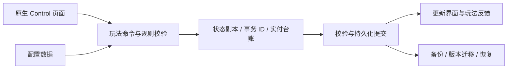

# 洪荒回合制养成与仙府经营

基于 **Godot 4.6.3 / GDScript** 的原生二维游戏原型，当前项目版本 **0.10.0**。围绕“组队战斗 → 角色与装备养成 → 仙府生产 → 资源反馈”构建核心玩法循环，使用配置化规则、原生 Control 界面及独立存档组织系统。

V0.10 按已确认的框架基线重制玩法：固定府主与四位神仙的阵容、培养实付台账、独立生产计划、周期玩法和分离保底等内容进入原生工程。当前仍为框架测试版，默认启用货币无消耗规则。

## 系统模块与实现入口

| 子系统 | 主要实现 | 代码入口 |
|---|---|---|
| 回合制战斗 | 阵容、行动、技能、状态及战斗反馈 | [`game_combat.gd`](scripts/game_combat.gd)、[`battle_view.gd`](scripts/battle_view.gd) |
| 角色与装备 | 培养规则、随机装备、主副属性、套装及实际投入记录 | [`game_equipment.gd`](scripts/game_equipment.gd)、[`game_progression.gd`](scripts/game_progression.gd) |
| 仙府经营 | 等距地块、独立建筑、建造计划、生产与离线推进 | [`estate_view.gd`](scripts/estate_view.gd)、[`game_estate_production.gd`](scripts/game_estate_production.gd) |
| 召唤与活动 | 常驻 / 限定 / 返场池、保底状态、奖励与周期记录 | [`game_economy.gd`](scripts/game_economy.gd)、[`game_activities.gd`](scripts/game_activities.gd) |
| 持久化 | 校验信封、备份、迁移、冲突检测与损坏恢复 | [`game_store.gd`](scripts/game_store.gd)、[`game_file_lock.gd`](scripts/game_file_lock.gd) |
| 原生交互 | Control UI、独立页面、分页、建造预览与召唤影片 | [`main.gd`](scripts/main.gd)、[`building_view.gd`](scripts/building_view.gd) |
| 规则与内容 | 角色、关卡、装备、设施和扩展规则 | [`data`](data) |

## 架构与核心流程



### Data-driven Design：配置化玩法

角色、关卡、装备与系统规则采用 JSON 配置，GDScript 模块负责解释规则并执行状态变更。将内容扩展与底层存档、经济、交互逻辑分开，减少新增角色或玩法时修改多个基础模块的成本。

战斗、经济、生产和持久化各有独立入口；原生 UI 调用实际玩法命令，避免以只变化文本或静态画面代替可保存的游戏状态。

### Transactional State：经济一致性

命令在状态副本执行，验证资产、规则和事务记录后才保存；同一事务 ID 拒绝重放。培养与生产保留真实投入，取消订单、重置和旧档退款依据实付台账，防止免费测试订单产生额外退款。

默认 `testing/free_currency=true` 免扣指定货币，但专用材料、次数、容量与时间约束仍适用；该模式不能用于评价正常资源供需或付费曲线。

### Persistence & Recovery：存档与中断恢复

原生存档使用版本化信封和 SHA256 校验，写入经过临时文件、flush、回读和有效备份保护。Linux 与 Windows 文件替换语义分别说明；Windows 的替换间隙通过备份和启动检测处理，不宣称所有平台具有相同原子性。

单写入者锁、磁盘指纹和修订号共同检测旧窗口覆盖；主档缺失但备份存在时进入恢复路径，避免静默初始化空档。旧 Canvas 存档必须显式导出 JSON 后验证迁移，原生工程不会自动读取浏览器 localStorage。

### Native Isometric Grid：原生等距经营

地面、建筑占地、点击命中、放置预览与搬迁共用同一等距坐标规则。建筑采用独立场景，交互对应实际地块和建筑实例；界面使用 Godot 原生 2D 与 Control，不依赖 WebView 包装。

## 运行与复验

使用 **Godot 4.6.3** 打开 `project.godot`，首次导入资源后运行。以下为 **PowerShell 或 Bash**，其中 `godot` 指本机引擎命令：

```sh
godot --headless --path . --editor --import --quit
godot --path .
```

测试必须使用独立用户数据目录，避免写入个人试玩存档。现有核心回归入口：

```sh
godot --headless --path . --script tests/test_combat.gd
godot --headless --path . --script tests/test_storage.gd -- --balanced-economy
```

`--balanced-economy` 用于原收费规则回归；默认免费模式由专门测试覆盖。命令、独立目录要求及原验证结果见 [`VALIDATION.md`](VALIDATION.md)，历史交付摘要见 [`validation/historical-summary.json`](validation/historical-summary.json)。

## 文档、状态与分发范围

- [V0.10 试玩指南](docs/V0.10-试玩指南.md) · [框架重制与验收](docs/V0.10-框架重制与验收.md)
- [经济规则](docs/Godot-economy.md) · [装备设计](docs/Godot-equipment.md)
- [存档迁移与恢复](docs/Godot存档与恢复.md) · [原生等距坐标](docs/ESTATE_NATIVE_GRID.md)
- [原生 UI](docs/Godot-native-UI.md) · [免费测试规则](docs/Test_Free_Currency.md)
- [本地模拟服务](docs/LOCAL_MOCK_SERVICES.md) · [素材来源记录](docs/asset-provenance.json)

2026-10-15 已核对当前交付主目录的代码与运行资源，并补齐原生网格、UI、测试规则及素材来源等工程文档，见 [`SOURCE_INVENTORY.json`](SOURCE_INVENTORY.json)。

本地仙盟、排行、账号或云档模拟功能按文档标记为本机模拟，不冒充真实在线服务。真实网络、支付、广告、抖音适配、后续完整内容与 UI 审美验收仍待完成；框架测试通过不等同商业成品完成。

运行素材、字体及来源清单按原工程保留；Noto 字体遵守附带许可。部分历史原画未随输入工程提供，不声称仓库包含缺失原稿。商业游戏参考截图、玩家存档、引擎二进制和导出安装包不在本仓库分发范围，也不对全部内容统一授予 MIT 许可。
